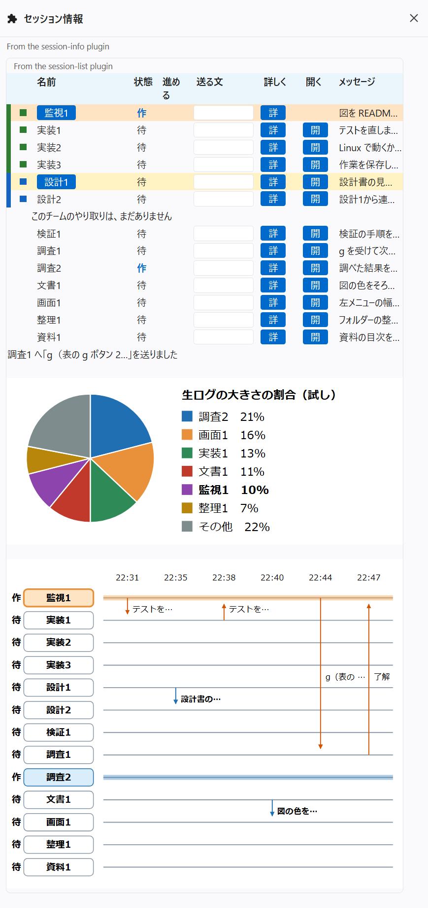

# claude-code-session-list

Claude Code の MOD「セッション一覧」（session-list）です。
MOD は、Claude Code の画面に、自分で作った部品を足す仕組みです。

セッション間のやり取りを、図で見るペインを開きます。やり取りは、SendMessage の合図と、黒板の連絡の2種類です。黒板は、決まったフォルダーに置く連絡のファイルです。黒板が無くても、この MOD は動きます（「気を付けること」を見てください）。

既定の簡単な表示（simple）は、直近24時間のやり取りのシーケンス図だけを出します。見るだけの表示で、ボタンや入力欄はありません。

| 図の部品 | 中身 |
|---|---|
| 横の行 | 1つのセッション。左の名札にセッションの名前、その左に状態の1文字（作＝作業中、待＝待機中）。このセッションは一番上の行で、名札と帯が薄い橙。作業中のセッションは、名札が薄い水色で、青い帯が付く |
| 縦の矢印 | 1回の連絡。1回が1列で、送り主の行から宛先の行へ向かう。橙は SendMessage の合図、青は黒板の連絡 |
| 時刻と件名 | 列の上に時刻、矢印の右に件名。未読の黒板の連絡は、件名が太字 |
| 左から右への並び | 時間の流れ。古い連絡が左、新しい連絡が右。新しいものから14件まで描く |

矢印にマウスを載せると、時刻、送り主と宛先、連絡の種類、件名が浮き出ます。列が狭いときは、図に時刻と件名を書かず、この浮き出る文だけで見せます。
描くのは、いま開いているセッションどうしのやり取りだけです。自動で起動されたセッション（起動の種類が sdk-cli のもの）は出しません。
ターミナルでは図を描けないので、1行ずつの文で出します。

設定の `view` を `detail` にすると、詳しい表示になります。シーケンス図の代わりに、次の欄を上から順に出します。

| 欄 | 中身 |
|---|---|
| 返事待ち・承認待ち | 人の手を待っているセッション。返（待機中で、最後の答えが問いで終わるか「お返事待ち」を含む）と、承（承認や入力の待ち）は赤。道具を使ったまま、会話の記録（生ログ）が20秒以上止まっているときは、「承認待ちかも」を黄色で出す |
| 送り先と入力 | 打って Enter を押すと、選んだセッションへ送る。送り先が「このセッション」なら、使う人が打ったのと同じ発言になる |
| 会話の地図 | 直近24時間に連絡し合った2つのセッションを1組1行で並べ、向きを矢印で示す図。新しい組から8組まで。1時間以内に連絡した組は濃い青の線。「隠す」と「出す」で切り替える |
| セッションの表 | 名前（直近30分の相手を ⇄ で添える）、ID の先頭8桁、SendMessage の宛先名、状態の1文字、生ログの大きさ。その下に、最後の指示、最後に使った道具、AI の要約（いまと次の2行） |
| やり取りの一覧 | 直近24時間の黒板の連絡と合図を、「送り主 → 宛先」と件名で20件まで並べる。黒板の連絡には、未読か既読かが付く |
| この画面からのやり取り | 入力欄から送った文と、返ってきた返事 |

ほかのセッションへ送る文には、入力欄から打った文だと伝える1行と、返事の返し方を書いた1行を添えます。
`【監視画面へ` の目印が付いた返事は、「この画面からのやり取り」に出し、このセッションの AI には渡しません。

生ログの大きさは2秒ごと、各セッションの様子（最後の指示、答え、道具）とやり取りは5秒ごと、セッションの顔ぶれは15秒ごとに読み直します。

## セッション情報MOD と1枚に並べる

セッション情報MOD（[claude-code-session-info](https://github.com/hatohato-lab/claude-code-session-info)）を一緒に入れると、その表のペイン（`/session-info`）の下に、この MOD が2つの図を足して、1枚に並べます（v0.7.21 からの試し）。

- 生ログの大きさの割合の円グラフ（大きい順に6つと、その他）
- セッション間のやり取りの図（簡単な表示と同じ図）



画像は、架空の名前と文面で作り直した見本です。
いまの公開版のセッション情報MOD（v0.18.0）では、並ばないことがあります。

## 入れ方

Claude Code のターミナルのセッションで、次の1行を打ちます。

```
/plugin install session-list --marketplace hatohato-lab/claude-code-session-list
```

マーケットプレイスを足すかを聞かれたら `y` を押し、入れる範囲（scope）を Enter で選びます。

シェルからは、次の1行です。

```
claude plugin install session-list --marketplace hatohato-lab/claude-code-session-list
```

デスクトップアプリでは、入力欄の横の + から Plugins を開き、Add marketplace に `hatohato-lab/claude-code-session-list` を入れてから、Add plugin で入れます。

クローンして使う場合は、フォルダーを指定して Claude Code を起動します。

```
git clone https://github.com/hatohato-lab/claude-code-session-list
claude --plugin-dir claude-code-session-list/session-list
```

入れたあとは、`/sessions` を打つとペインが開きます。ペインは自分からは開きません。閉じたあとも、`/sessions` で開き直せます。
ペインを開いたセッションでだけ動き、閉じると止まります。

## 設定

設定（userConfig）は次の5つです。

| 設定 | 中身 |
|---|---|
| `view` | 表示の形。`simple`（既定）はシーケンス図だけ。`detail` は詳しい表示 |
| `senderName` | 入力欄からほかのセッションへ送る文の、頭の1行に入れる呼び名。空（既定）なら名前を入れない |
| `workspaceDir` | 黒板（`00_黒板\Claude`）があるフォルダーの絶対パス。空（既定）なら、セッションの作業フォルダーを使う |
| `summaries` | AI の要約を作るか。既定は作る（`true`）。要約を作るのは、詳しい表示のときだけ |
| `summaryModel` | 要約に使うモデルの名前。既定は `haiku` |

## 必要なもの

- Claude Code 2.1.300 以降
- Python 3（Windows では `python`、Linux と macOS では `python3` の名前で回します。その名前で起動できなければ、もう一方の名前で回します）
- Windows か Linux。Linux は、GitHub Actions（ubuntu-latest）で、テスト、同梱の Python、マーケットプレイスからの入れ方を確かめています。画面に出るところを実際に確かめたのは Windows です。macOS は確かめていません

図と表の材料は、同梱の `tools/在席表.py`、`tools/合図表.py`、`tools/様子表.py` が、手元の `~/.claude/sessions` と `~/.claude/projects` を読んで作ります。読むだけで、何も書き換えません。`在席表.py` は、同じフォルダーに `在席表_名前の補い.json`（名前の無いセッションに名前を補う表）があれば、それも読みます。

## 気を付けること

- 詳しい表示では、AI の要約のたびに小さなモデル（既定は haiku）を呼ぶので、少し使用量がかかります。要約には、そのセッションの直近の依頼と答え（2500字まで）を渡します。様子が変わったセッションだけを、1つにつき3分に1回まで要約します。要らないときは、`summaries` を切ってください。既定の簡単な表示では、要約を作りません
- 入力欄から送った文は、ほかのセッションには「ほかのセッションからの連絡」として届きます。受け取った側の AI は、ふつうはこれを使う人の承認として扱いません
- MOD は、自分のフォルダーに小さな動作の記録を書きます。`起動記録.txt` には、セッションが始まるたびに版と時刻を書きます。`表示記録.txt` には、簡単な表示でペインの大きさが変わったときに、時刻と大きさを書きます。どちらも中身は1行です
- 黒板のフォルダーは、ワークスペースの中の `00_黒板\Claude` です。ワークスペースは、設定の `workspaceDir` か、空ならセッションの作業フォルダーです。このフォルダーがあれば、そこにあるファイルの名前を連絡として出します。ファイル名は `YYYYMMDD_HHMM_送り主→宛先_種類_件名.md` の形で読み、`_既読.md` で終わるものは既読として出します。ファイルの中身は読みません。フォルダーが無ければ、黒板の連絡は出しません

## ほかの MOD

MOD は1つずつ、別のリポジトリにしています。

| リポジトリ | 中身 |
|---|---|
| [claude-code-session-info](https://github.com/hatohato-lab/claude-code-session-info) | セッション情報。開いている全セッションを1行ずつの表で見るペイン |
| [claude-code-active-rules](https://github.com/hatohato-lab/claude-code-active-rules) | 効いているルール。いま読み込まれているルールを表で見るペイン |

## ライセンス

MIT（`LICENSE` を見てください）
